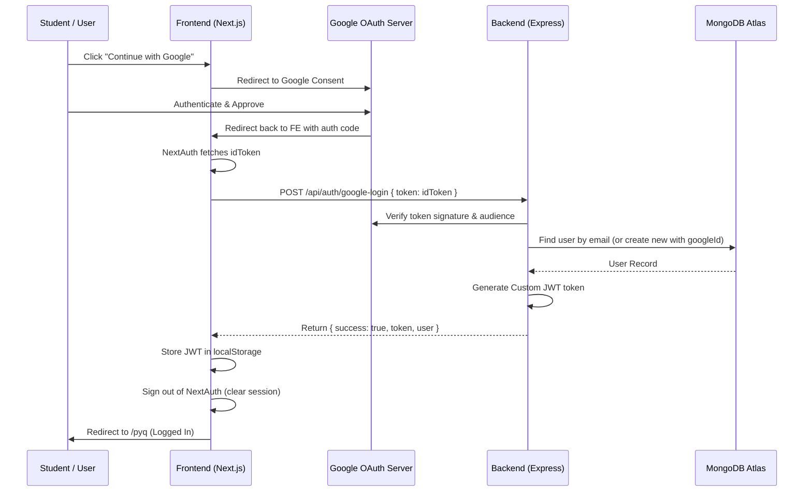

# Google Login Integration Guide

This guide explains how Google Sign-In is structured in the InvertisPrep application, how to configure the Google Cloud Console credentials, the environment variables required, and how to verify or troubleshoot the integration.

---

## 1. Architecture Overview

InvertisPrep uses a hybrid authentication architecture:
1. **Frontend Mediator (NextAuth)**: The client application (Next.js) uses `next-auth` to orchestrate the Google OAuth flow. When the user signs in with Google, NextAuth handles the handshake, retrieves Google's signed ID token, and exposes it in the client-side session.
2. **Backend Authentication (Express & JWT)**: The backend server (Express) handles session-less authentication using custom JWT tokens. 
3. **The Token Exchange**:
   - The user triggers Google Sign-In on the frontend.
   - NextAuth redirects the user to Google.
   - Once authenticated, Google redirects back to NextAuth, landing the user back on the frontend's login page.
   - The login page detects the active NextAuth session and sends the Google `idToken` to the backend `/api/auth/google-login` endpoint.
   - The backend validates the `idToken` using Google's public certificates, registers/updates the user in the database (mapping their unique Google User ID to the `googleId` field), and issues a custom JWT token.
   - The frontend saves this custom JWT token in `localStorage`, clears the NextAuth session, and redirects the user to `/pyq`.



---

## 2. Google Cloud Console Configuration

To use Google Sign-In, you must configure a project in the [Google Cloud Console API Credentials](https://console.cloud.google.com/).

### Steps:
1. Go to the **APIs & Services > Credentials** section.
2. Click **Create Credentials** and choose **OAuth client ID**.
3. Select **Web application** as the application type.
4. Set the **Authorized JavaScript origins**:
   - `http://localhost:3000` (for development)
   - `https://yourdomain.com` (for production)
5. Set the **Authorized redirect URIs**:
   - `http://localhost:3000/api/auth/callback/google` (for development)
   - `https://yourdomain.com/api/auth/callback/google` (for production)
6. Save and copy the **Client ID** and **Client Secret**.

---

## 3. Environment Variables

Ensure the following environment variables are correctly set in the environment files.

### Frontend (`client/.env.local` or `client/.env`)
```env
NEXT_PUBLIC_API_URL=http://localhost:5000/api
NEXTAUTH_URL=http://localhost:3000
NEXTAUTH_SECRET=a-secure-random-secret-key-32-chars-long
GOOGLE_CLIENT_ID=your-google-client-id.apps.googleusercontent.com
GOOGLE_CLIENT_SECRET=your-google-client-secret
```

### Backend (`server/.env`)
```env
PORT=5000
MONGODB_URI=your-mongodb-connection-string
JWT_SECRET=your-jwt-signing-secret
GOOGLE_CLIENT_ID=your-google-client-id.apps.googleusercontent.com
GOOGLE_CLIENT_SECRET=your-google-client-secret
CLIENT_URL=http://localhost:3000
```

> [!IMPORTANT]
> The `GOOGLE_CLIENT_ID` and `GOOGLE_CLIENT_SECRET` must be identical on both the frontend and backend. Mismatched client IDs will result in `401 Unauthorized` token validation errors from the backend.

---

## 4. Verification and Troubleshooting

### Verifying Successful Integration
1. Start both servers:
   - Server: `npm run dev` in `/server`
   - Client: `npm run dev` in `/client`
2. Navigate to `http://localhost:3000/login`.
3. Click "Continue with Google".
4. After signing in through Google, you should be automatically redirected back to `/login` (briefly showing "Signing in...") and then redirected to `/pyq` as a logged-in student.
5. Inspect the local storage in your browser (`Developer Tools > Application > Local Storage > http://localhost:3000`):
   - You should see `token` and `user` keys set correctly.
6. Check your MongoDB `users` collection:
   - The user record should have a `googleId` field populated with their stable, unique Google ID (the `sub` claim).

### Troubleshooting Errors
- **Error: "Failed to retrieve session..."**: This usually happens if the NextAuth API route is missing or misconfigured. Ensure `client/app/api/auth/[...nextauth]/route.ts` is in place.
- **Error: "Invalid or expired Google token" / "401 Unauthorized"**:
  - Verify that the `GOOGLE_CLIENT_ID` in `client/.env` (or `.env.local`) matches the one in `server/.env` exactly.
  - Verify that the system clock on the host running the server is in sync.
- **Error: "redirect_uri_mismatch"**:
  - Double check your Google Cloud Console settings and ensure `http://localhost:3000/api/auth/callback/google` is added to the Authorized Redirect URIs.
